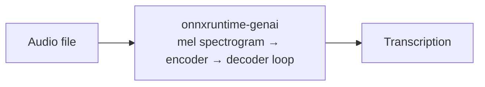

# Whisper Speech-to-Text

Transcribe and translate speech using OpenAI's Whisper models, with automatic chunking for long audio.

See the [overview](introduction.md) for background on how autoregressive generation differs from single-pass inference.

## Models

| Model ID | Parameters | Size | 11 s clip on CPU* |
|----------|------------|------|-------------------|
| `inference4j/whisper-tiny-genai` | 39M | ~225 MB | ~0.1 s |
| `inference4j/whisper-small-genai` | 244M | ~1.1 GB | ~0.5 s |

\* Measured on an Apple M4 Pro. Both are FP32 exports made with onnxruntime-genai's model builder,
and download on first use.

`small` transcribes noticeably better, including punctuation such as commas; `tiny` is the
choice when size and speed matter most.

!!! note "Verified for English transcription"

    Our tests cover English transcription. Whisper also supports 98 other languages and
    translation to English (shown below), but we have not verified those yet.

## Quick example

```java
try (var whisper = WhisperSpeechModel.builder()
        .modelId("inference4j/whisper-small-genai")
        .build()) {
    System.out.println(whisper.transcribe(Path.of("meeting.wav")).text());
}
```

## Full example

```java
import io.github.inference4j.genai.audio.WhisperSpeechModel;
import io.github.inference4j.audio.Transcription;
import java.nio.file.Path;

public class WhisperTranscription {
    public static void main(String[] args) {
        try (var whisper = WhisperSpeechModel.builder()
                .modelId("inference4j/whisper-small-genai")
                .build()) {

            Transcription result = whisper.transcribe(Path.of("meeting.wav"));
            System.out.println(result.text());
        }
    }
}
```

## Translation

Whisper can translate speech from any supported language into English:

```java
try (var whisper = WhisperSpeechModel.builder()
        .modelId("inference4j/whisper-small-genai")
        .language("fr")
        .task(WhisperTask.TRANSLATE)
        .build()) {
    Transcription result = whisper.transcribe(Path.of("french-audio.wav"));
    System.out.println(result.text());  // English translation
}
```

## From raw audio data

If you already have audio samples as a float array:

```java
try (var whisper = WhisperSpeechModel.builder()
        .modelId("inference4j/whisper-small-genai")
        .build()) {
    float[] samples = loadAudioSamples();
    Transcription result = whisper.transcribe(samples, 16000);
    System.out.println(result.text());
}
```

## Builder options

| Method | Type | Default | Description |
|--------|------|---------|-------------|
| `.modelId(String)` | `String` | — | HuggingFace model ID (required) |
| `.modelSource(ModelSource)` | `ModelSource` | `HuggingFaceModelSource` | Model resolution strategy |
| `.language(String)` | `String` | `"en"` | Source language code (e.g., `"fr"`, `"de"`, `"ja"`) |
| `.task(WhisperTask)` | `WhisperTask` | `TRANSCRIBE` | `TRANSCRIBE` or `TRANSLATE` (to English) |
| `.maxLength(int)` | `int` | `448` | Maximum number of tokens to generate per chunk |
| `.temperature(double)` | `double` | `0.0` | Sampling temperature (0 = greedy) |
| `.topK(int)` | `int` | `0` (disabled) | Top-K sampling |
| `.topP(double)` | `double` | `0.0` (disabled) | Nucleus sampling |

## Result type

`Transcription` is a record with:

| Field | Type | Description |
|-------|------|-------------|
| `text()` | `String` | The transcribed or translated text |
| `segments()` | `List<Segment>` | Timed segments — always empty for Whisper, which runs without timestamps |

Each `Segment` contains:

| Field | Type | Description |
|-------|------|-------------|
| `text()` | `String` | Segment text |
| `startTime()` | `float` | Start time in seconds |
| `endTime()` | `float` | End time in seconds |

## Long audio

Whisper sees **30 seconds of audio per pass**; this is a property of the model, not of
inference4j. On its own, `WhisperSpeechModel` handles longer audio by cutting it every 30
seconds. Those cuts land in the middle of words and sentences, and Whisper then drops or repeats
text around them, sometimes losing a whole 30-second chunk.

For recordings longer than 30 seconds, wrap the model in `SegmentedSpeechRecognizer`, which cuts
at pauses found by [voice activity detection](../use-cases/voice-activity-detection.md):

```java
try (SpeechRecognizer recognizer = new SegmentedSpeechRecognizer(
        WhisperSpeechModel.builder().modelId("inference4j/whisper-small-genai").build(),
        SileroVadDetector.builder().build())) {
    System.out.println(recognizer.transcribe(Path.of("meeting.wav")).text());
}
```

| Word error rate (lower is better) | Cut every 30 s | `SegmentedSpeechRecognizer` | HF `transformers` chunked | HF `transformers` sequential |
|---|---|---|---|---|
| whisper-tiny  | 13.2% | **6.1%** | 6.1% | 6.5% |
| whisper-small | 11.7% | **3.7%** | 3.7% | 3.9% |

Measured on the 11 talks of the [TED-LIUM long-form](https://huggingface.co/datasets/distil-whisper/tedlium-long-form)
test set (148 minutes), with Whisper's standard English text normalizer. The two right-hand
columns run the same models through the HuggingFace `transformers` reference implementation's
long-form strategies (30-second chunks with 5-second overlap, and OpenAI's timestamp-driven
sequential decoding). The voice activity detection adds processing time: 12% with
whisper-small (302 s instead of 270 s for all 11 talks on an Apple M4 Pro CPU) and 40% with the
much faster whisper-tiny (74 s instead of 53 s).

Cutting at pauses roughly halves tiny's error rate and cuts small's by two thirds, matching
the reference implementation. See [Long recordings](../use-cases/speech-to-text.md#long-recordings) for how the cuts are
chosen.

## How it works

Unlike [Wav2Vec2](../use-cases/speech-to-text.md) (single-pass CTC), Whisper is an
**autoregressive** encoder-decoder model. The audio is encoded into a mel spectrogram,
then the decoder generates text tokens one at a time.



All heavy lifting — mel spectrogram computation, encoder forward pass, autoregressive
decoding and the KV cache — is handled natively by onnxruntime-genai's C++ layer.

## Whisper vs Wav2Vec2

| | Wav2Vec2 | Whisper |
|---|---------|---------|
| Architecture | CTC (single-pass) | Encoder-decoder (autoregressive) |
| Speed | Fast | Slower (token-by-token) |
| Accuracy | Good on clean speech | Better on diverse audio |
| Languages | English (default model) | 99 languages |
| Translation | No | Yes (to English) |
| Module | `inference4j-core` | `inference4j-genai` |

## Tips

- Use `WhisperTask.TRANSLATE` to translate any language to English in a single step.
- Smaller models (tiny, base) are faster but less accurate. The `small` model is a good balance.
- `temperature(0.0)` (default) gives deterministic, greedy decoding — best for transcription accuracy.
- Reuse `WhisperSpeechModel` instances — each one holds the model in memory.
- For short, clean English audio where speed matters, [Wav2Vec2](../use-cases/speech-to-text.md) may be a better fit.
