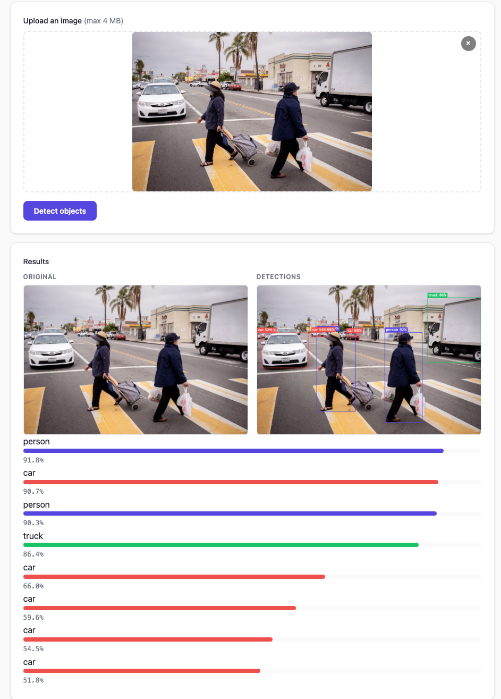

# Object Detection

Detect and locate objects in images. Every detector implements `ObjectDetector` and returns the same `Detection`
type, so one model can replace another without code changes.

## Quick example

```java
try (ObjectDetector detector = DetrDetector.builder().build()) {      // D-FINE small, Apache-2.0
    List<Detection> detections = detector.detect(Path.of("street.jpg"));
    // [Detection[label=car, confidence=0.94, box=BoundingBox[...]], ...]
}
```

## Choose a model

| Preset | Model | Weights license | COCO AP (authors) | ONNX size | CPU latency* |
|--------|-------|-----------------|-------------------|-----------|--------------|
| `DetrDetector.dfineNano()` | D-FINE nano | **Apache-2.0** | 42.8 | 15 MB | 29 ms |
| `DetrDetector.dfineSmall()` (default) | D-FINE small | **Apache-2.0** | 48.5 | 41 MB | 54 ms |
| `DetrDetector.dfineMedium()` | D-FINE medium | **Apache-2.0** | 52.3 | 79 MB | — |
| `DetrDetector.dfineLarge()` | D-FINE large | **Apache-2.0** | 54.0 | 125 MB | — |
| `DetrDetector.rtDetrV2()` | RT-DETRv2 ResNet-18 | **Apache-2.0** | 48.1 | 81 MB | 108 ms |
| `YoloXDetector.nano()` | YOLOX-Nano (416 × 416) | **Apache-2.0** | 25.8 | 3.5 MB | — |
| `YoloXDetector.tiny()` | YOLOX-Tiny (416 × 416) | **Apache-2.0** | 32.8 | 19 MB | — |
| `YoloXDetector.s()` | YOLOX-S | **Apache-2.0** | 40.5 | 34 MB | — |
| `Yolo26Detector.builder()` | YOLO26n | AGPL-3.0 | 40.9 | 10 MB | 17 ms |
| `YoloV8Detector.builder()` | YOLOv8n (also loads YOLO11 exports) | AGPL-3.0 | — | 13 MB | — |

\*Median per image at 640 × 640 on a laptop CPU with four ONNX Runtime threads, measured with inference4j. AP figures
come from the [D-FINE](https://github.com/Peterande/D-FINE), [RT-DETRv2](https://github.com/lyuwenyu/RT-DETR),
[YOLOX](https://github.com/Megvii-BaseDetection/YOLOX) and [YOLO26](https://docs.ultralytics.com/models/yolo26/) authors (COCO val2017); inference4j has not
re-measured them. Latency for D-FINE medium and large and for YOLOX is not measured yet.

- **Start with D-FINE small**: a good balance of accuracy and speed, and Apache-2.0.
- **D-FINE medium or large** when accuracy matters more than speed.
- **D-FINE nano** when speed or size matters most.
- **YOLOX-Nano** for the smallest download (3.5 MB) and small CPUs, at lower accuracy.
- **YOLO26n** is the fastest, but its weights are AGPL-3.0; see [Licenses](#licenses).

## Full example

```java
import io.github.inference4j.vision.Detection;
import io.github.inference4j.vision.DetrDetector;
import io.github.inference4j.vision.ObjectDetector;
import java.nio.file.Path;
import java.util.List;

public class ObjectDetection {
    public static void main(String[] args) {
        try (ObjectDetector detector = DetrDetector.builder().build()) {
            List<Detection> detections = detector.detect(Path.of("street.jpg"));

            for (Detection d : detections) {
                System.out.printf("%-12s (%.0f%%) at [%.0f, %.0f, %.0f, %.0f]%n",
                    d.label(), d.confidence() * 100,
                    d.box().x1(), d.box().y1(), d.box().x2(), d.box().y2());
            }
        }
    }
}
```

<figure markdown="span">
  
  <figcaption>Screenshot from showcase app</figcaption>
</figure>

## Licenses

The wrapper code is Apache-2.0 for every detector. The license that matters is the one of the weights a detector
downloads:

| Weights | License | Source |
|---------|---------|--------|
| D-FINE nano, small, medium, large | Apache-2.0 | [D-FINE license](https://github.com/Peterande/D-FINE/blob/master/LICENSE) |
| RT-DETRv2 ResNet-18 | Apache-2.0 | [RT-DETR license](https://github.com/lyuwenyu/RT-DETR/blob/main/LICENSE) |
| YOLOX-Nano, Tiny, S | Apache-2.0 | [YOLOX license](https://github.com/Megvii-BaseDetection/YOLOX/blob/main/LICENSE) |
| YOLOv8n, YOLO26n | AGPL-3.0 | [Ultralytics license](https://github.com/ultralytics/ultralytics/blob/main/LICENSE) |

AGPL-3.0 generally obliges a network service or a distributed product that uses the weights to release its own source
code under the same license, unless an Ultralytics commercial license is bought. Apache-2.0 has no such obligation.
When `YoloV8Detector` or `Yolo26Detector` loads its default weights (`inference4j/yolov8n`, `inference4j/yolo26n`),
`build()` logs a warning that points to `DetrDetector`; it does not warn for other model ids.

This page is not legal advice; check the licenses for your use.

## Available models

### D-FINE and RT-DETRv2 (Apache-2.0)

NMS-free transformer detectors. Each of the 300 object queries scores every class; the best (query, class) pairs
above the threshold become detections.

```java
try (var detector = DetrDetector.builder().build()) {        // D-FINE small
    detector.detect(Path.of("image.jpg"));
}

try (ObjectDetector detector = DetrDetector.dfineNano().build()) {   // fastest D-FINE
    detector.detect(Path.of("image.jpg"));
}
```

Processing follows HuggingFace `transformers` (`RTDetrImageProcessor`): the image is resized to 640 × 640 with
Pillow's bilinear filter, without letterboxing, and scaled to [0, 1]. On six COCO photos, inference4j returns the same
detections as `transformers` with the PyTorch models: same classes in the same order, scores within 1e-5, boxes within
0.2 pixels. Labels default to `Labels.coco()`, as for the YOLO detectors, so swapping detectors keeps label names.

### YOLOX (Apache-2.0)

Anchor-free CNN detector from Megvii, with non-maximum suppression. The presets are the authors' COCO models,
published unchanged from their release; Nano and Tiny take a 416 × 416 input, S takes 640 × 640.

```java
try (ObjectDetector detector = YoloXDetector.nano().build()) {
    detector.detect(Path.of("image.jpg"));
}
```

Processing follows the official ONNX Runtime demo: the image is scaled to fit the input with OpenCV's bilinear
resize, placed at the top left and padded with gray, and passed as BGR with values 0–255. Scores are objectness ×
class score; overlapping boxes are removed whatever their class. On the test images, inference4j returns the
demo's detections: scores within 0.01, boxes within 1.5 pixels.

### YOLOv8 / YOLO11 (AGPL-3.0 weights)

NMS-based detection. The `YoloV8Detector` is compatible with both YOLOv8 and YOLO11 models (same output layout).

```java
try (var detector = YoloV8Detector.builder().build()) {
    detector.detect(Path.of("image.jpg"));
}
```

### YOLO26 (AGPL-3.0 weights)

NMS-free detection. The architecture outputs 300 deduplicated proposals directly — no post-processing NMS needed.

```java
try (var detector = Yolo26Detector.builder().build()) {
    detector.detect(Path.of("image.jpg"));
}
```

!!! note
    YOLO26 accepts an `iouThreshold` parameter for API compatibility, but it is ignored — the architecture handles deduplication internally.

## Builder options

All detector builders share these options:

| Method | Type | Description |
|--------|------|-------------|
| `.modelId(String)` | `String` | HuggingFace model ID |
| `.modelSource(ModelSource)` | `ModelSource` | Model resolution strategy; defaults to `HuggingFaceModelSource` |
| `.sessionOptions(SessionConfigurer)` | `SessionConfigurer` | ONNX Runtime session config |
| `.labels(Labels)` | `Labels` | Class names by class index; see [Labels](#labels) |
| `.inputSize(int)` | `int` | Side of the square model input. A model with a fixed input size uses it, and a different value fails at `build()`; otherwise defaults to `640` |
| `.confidenceThreshold(float)` | `float` | Minimum detection confidence |
| `.maxDetections(int)` | `int` | Most detections returned per image, the most confident first; defaults to `300` |

### Labels

The first match wins:

1. labels set with `.labels(...)`;
2. for the presets (`dfineSmall()`, `dfineNano()`, `dfineMedium()`, `dfineLarge()`, `rtDetrV2()`, `YoloXDetector`'s
   `nano()`, `tiny()` and `s()`, the YOLOv8 and YOLO26 defaults), the 80 COCO classes from
   `Labels.coco()`, so every preset reports the same names;
3. for a custom model, a `labels.txt` in its directory, one name per line;
4. the `id2label` map of its `config.json`, as exported by HuggingFace `transformers`;
5. the 80 COCO classes.

Defaults and extra options per detector:

| Detector | Default `modelId` | Default `confidenceThreshold` | Extra options |
|----------|-------------------|-------------------------------|---------------|
| `DetrDetector` | `inference4j/dfine-small-coco`; presets `dfineSmall()`, `dfineNano()`, `dfineMedium()`, `dfineLarge()`, `rtDetrV2()` | `0.5` | none |
| `YoloXDetector` | `inference4j/yolox-nano`; presets `nano()`, `tiny()`, `s()` | `0.3` | `.iouThreshold(float)`: NMS IoU threshold, `0.45` |
| `Yolo26Detector` | `inference4j/yolo26n` | `0.5` | `.inputName(String)`: input tensor name, auto-detected |
| `YoloV8Detector` | `inference4j/yolov8n` | `0.25` | `.inputName(String)`; `.iouThreshold(float)`: NMS IoU threshold, `0.45` |

!!! note "Renamed in 0.15.0"
    `DetrDetector` was called `RtDetrDetector` before 0.15.0. The old name still works, with the same presets and
    options, but is deprecated and will be removed in 0.16.0.

## Result type

`Detection` is a record with:

| Field | Type | Description |
|-------|------|-------------|
| `label()` | `String` | Class label (e.g., `car`, `person`) |
| `classIndex()` | `int` | Class index in the label set |
| `confidence()` | `float` | Detection confidence (0.0 to 1.0) |
| `box()` | `BoundingBox` | Bounding box coordinates |

`BoundingBox` provides:

| Field | Type | Description |
|-------|------|-------------|
| `x1()` | `float` | Left coordinate |
| `y1()` | `float` | Top coordinate |
| `x2()` | `float` | Right coordinate |
| `y2()` | `float` | Bottom coordinate |

Coordinates are in the original image's pixel space (not normalized).

## Custom thresholds

Override the confidence threshold per call. Each detector keeps its configured IoU threshold:

```java
try (ObjectDetector detector = DetrDetector.builder().build()) {
    List<Detection> confident = detector.detect(Path.of("image.jpg"), 0.7f);
}
```

The three-argument form also sets the NMS IoU threshold. Only `YoloV8Detector` and `YoloXDetector` use it; the NMS-free detectors
(`DetrDetector`, `Yolo26Detector`) ignore it:

```java
try (var detector = YoloV8Detector.builder().build()) {
    // Stricter confidence, tighter NMS
    List<Detection> detections = detector.detect(Path.of("image.jpg"), 0.5f, 0.3f);
}
```

## Swap contract

Every detector follows the same contract, checked by one test that runs against every preset:

- boxes are in pixel coordinates of the original image (not normalized), inside the image;
- detections are sorted by descending confidence;
- with the default labels, `classIndex` is a contiguous COCO index (0 to 79) and `label` is
  `Labels.coco().get(classIndex)`;
- `Path` and `BufferedImage` inputs give the same detections for the same image.

So replacing one detector with another changes only the builder line, when variables are typed as `ObjectDetector`.

## Custom detectors

`DetectionOps` holds the building blocks the detectors share, for implementing `ObjectDetector` over another model:

| Method | Purpose |
|--------|---------|
| `Letterbox.centered(w, h, size)`, `Letterbox.topLeft(w, h, size)` | Aspect-preserving scale into a square input; `apply(image, padColor)` draws it, `toOriginal(box, w, h)` maps a box back |
| `pixels(image)`, `toChw(pixels, w, h)` | Planar RGB floats in [0, 1]; an overload adds mean/std normalization and BGR order |
| `nms(detections, iou, classAware, maxDetections)` | Non-maximum suppression, across classes or per class |
| `decodeQueries(logits, boxes, ...)` | DETR-style query outputs to detections: `TOP_PAIRS` (D-FINE, RT-DETR) or `BEST_CLASS_PER_QUERY` (YOLO26) |

## Tips

- **Type variables as `ObjectDetector`** to keep the model swappable: changing the builder line is then the only
  change needed.
- **YOLOv8 vs YOLO26**: YOLOv8 is widely tested; YOLO26 is NMS-free and newer.
- All detectors accept `Path` or `BufferedImage` as input.
- Default labels are COCO (80 classes). Override with `.labels(Labels.of(yourLabels))` for custom-trained models.
- YOLOv8 uses letterbox preprocessing (preserves aspect ratio, pads with gray), YOLOX the same with the image at the
  top left. YOLO26 and `DetrDetector` use direct resize.
