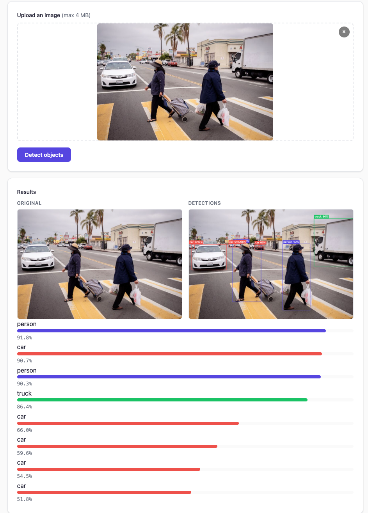

# Object Detection

Detect and locate objects in images. inference4j offers YOLO models (NMS-based YOLOv8/YOLO11 and NMS-free YOLO26) and
Apache-2.0 transformer detectors (D-FINE and RT-DETRv2) that can be used in proprietary software.

## Licenses

The YOLO models come from Ultralytics and are released under **AGPL-3.0**: using them in a network service or a
distributed product generally obliges you to release your own source code under the same license, unless you buy an
Ultralytics commercial license. D-FINE and RT-DETRv2 are **Apache-2.0**, with no such obligation.

| Wrapper | Models | License | COCO AP (as reported by the authors) | CPU latency* |
|---------|--------|---------|--------------------------------------|--------------|
| `Yolo26Detector` | YOLO26n | AGPL-3.0 | 40.9 | 17 ms |
| `YoloV8Detector` | YOLOv8n, YOLO11 | AGPL-3.0 | — | — |
| `RtDetrDetector.dfineNano()` | D-FINE nano | **Apache-2.0** | 42.8 | 29 ms |
| `RtDetrDetector.dfineSmall()` (default) | D-FINE small | **Apache-2.0** | 48.5 | 54 ms |
| `RtDetrDetector.rtDetrV2()` | RT-DETRv2 ResNet-18 | **Apache-2.0** | 48.1 | 108 ms |

\*Median per image at 640 × 640 on a laptop CPU with four ONNX Runtime threads, measured with inference4j. AP figures
come from the [D-FINE](https://github.com/Peterande/D-FINE), [RT-DETRv2](https://github.com/lyuwenyu/RT-DETR) and
[YOLO26](https://docs.ultralytics.com/models/yolo26/) authors (COCO val2017); inference4j has not re-measured them.
This page is not legal advice; check the licenses for your use.

## Quick example

```java
try (var detector = YoloV8Detector.builder().build()) {
    List<Detection> detections = detector.detect(Path.of("street.jpg"));
    // [Detection[label=car, confidence=0.94, box=BoundingBox[...]], ...]
}
```

## Full example

```java
import io.github.inference4j.vision.YoloV8Detector;
import io.github.inference4j.vision.Detection;
import java.nio.file.Path;

public class ObjectDetection {
    public static void main(String[] args) {
        try (var detector = YoloV8Detector.builder().build()) {
            List<Detection> detections = detector.detect(Path.of("street.jpg"));

            for (Detection d : detections) {
                System.out.printf("%-12s (%.0f%%) at [%.0f, %.0f, %.0f, %.0f]%n",
                    d.label(), d.confidence() * 100,
                    d.box().x1(), d.box().y1(), d.box().x2(), d.box().y2());
            }
        }
    }
}
```

<figure markdown="span">
  
  <figcaption>Screenshot from showcase app</figcaption>
</figure>

## Available models

### YOLOv8 / YOLO11

NMS-based detection. The `YoloV8Detector` is compatible with both YOLOv8 and YOLO11 models (same output layout).

```java
try (var detector = YoloV8Detector.builder().build()) {
    detector.detect(Path.of("image.jpg"));
}
```

### YOLO26

NMS-free detection. The architecture outputs 300 deduplicated proposals directly — no post-processing NMS needed.

```java
try (var detector = Yolo26Detector.builder().build()) {
    detector.detect(Path.of("image.jpg"));
}
```

!!! note
    YOLO26 accepts an `iouThreshold` parameter for API compatibility, but it is ignored — the architecture handles deduplication internally.

### D-FINE and RT-DETRv2 (Apache-2.0)

NMS-free transformer detectors. Each of the 300 object queries scores every class; the best (query, class) pairs
above the threshold become detections.

```java
try (var detector = RtDetrDetector.builder().build()) {        // D-FINE small
    detector.detect(Path.of("image.jpg"));
}

try (ObjectDetector detector = RtDetrDetector.dfineNano().build()) {   // drop-in for a YOLO detector
    detector.detect(Path.of("image.jpg"));
}
```

Processing follows HuggingFace `transformers` (`RTDetrImageProcessor`): the image is resized to 640 × 640 with
Pillow's bilinear filter, without letterboxing, and scaled to [0, 1]. On six COCO photos, inference4j returns the same
detections as `transformers` with the PyTorch models: same classes in the same order, scores within 1e-5, boxes within
0.2 pixels. Labels default to `Labels.coco()`, as for the YOLO detectors, so swapping detectors keeps label names.

## YoloV8 builder options

| Method | Type | Default | Description |
|--------|------|---------|-------------|
| `.modelId(String)` | `String` | `inference4j/yolov8n` | HuggingFace model ID |
| `.modelSource(ModelSource)` | `ModelSource` | `HuggingFaceModelSource` | Model resolution strategy |
| `.sessionOptions(SessionConfigurer)` | `SessionConfigurer` | default | ONNX Runtime session config |
| `.labels(Labels)` | `Labels` | COCO (80 classes) | Detection class labels |
| `.inputName(String)` | `String` | auto-detected | Input tensor name |
| `.inputSize(int)` | `int` | `640` | Model input resolution |
| `.confidenceThreshold(float)` | `float` | `0.25` | Minimum detection confidence |
| `.iouThreshold(float)` | `float` | `0.45` | NMS IoU threshold |

## Yolo26 builder options

| Method | Type | Default | Description |
|--------|------|---------|-------------|
| `.modelId(String)` | `String` | `inference4j/yolo26n` | HuggingFace model ID |
| `.modelSource(ModelSource)` | `ModelSource` | `HuggingFaceModelSource` | Model resolution strategy |
| `.sessionOptions(SessionConfigurer)` | `SessionConfigurer` | default | ONNX Runtime session config |
| `.labels(Labels)` | `Labels` | COCO (80 classes) | Detection class labels |
| `.inputName(String)` | `String` | auto-detected | Input tensor name |
| `.inputSize(int)` | `int` | `640` | Model input resolution |
| `.confidenceThreshold(float)` | `float` | `0.5` | Minimum detection confidence |

## RtDetrDetector builder options

| Method | Type | Default | Description |
|--------|------|---------|-------------|
| `.modelId(String)` | `String` | `inference4j/dfine-small-coco` | HuggingFace model ID; presets `dfineSmall()`, `dfineNano()`, `rtDetrV2()` |
| `.modelSource(ModelSource)` | `ModelSource` | `HuggingFaceModelSource` | Model resolution strategy |
| `.sessionOptions(SessionConfigurer)` | `SessionConfigurer` | default | ONNX Runtime session config |
| `.labels(Labels)` | `Labels` | COCO (80 classes) | Detection class labels |
| `.inputSize(int)` | `int` | `640` | Model input resolution |
| `.confidenceThreshold(float)` | `float` | `0.5` | Detections scoring at or below this are dropped |

`detect(image, confidenceThreshold, iouThreshold)` ignores the IoU threshold: these models need no NMS.

## Result type

`Detection` is a record with:

| Field | Type | Description |
|-------|------|-------------|
| `label()` | `String` | Class label (e.g., `car`, `person`) |
| `classIndex()` | `int` | Class index in the label set |
| `confidence()` | `float` | Detection confidence (0.0 to 1.0) |
| `box()` | `BoundingBox` | Bounding box coordinates |

`BoundingBox` provides:

| Field | Type | Description |
|-------|------|-------------|
| `x1()` | `float` | Left coordinate |
| `y1()` | `float` | Top coordinate |
| `x2()` | `float` | Right coordinate |
| `y2()` | `float` | Bottom coordinate |

Coordinates are in the original image's pixel space (not normalized).

## Custom thresholds

Override thresholds per-call:

```java
try (var detector = YoloV8Detector.builder().build()) {
    // Stricter confidence, tighter NMS
    List<Detection> detections = detector.detect(
        Path.of("image.jpg"), 0.5f, 0.3f);
}
```

## Tips

- **Licensing first**: if your product is not open source under AGPL-3.0, start with `RtDetrDetector`. D-FINE small is
  more accurate than YOLO26n by the authors' figures, at about three times the CPU time; D-FINE nano is slightly more
  accurate than YOLO26n and a little slower (29 vs 17 ms here).
- **YOLOv8 vs YOLO26**: YOLOv8 is the safer default — widely tested and well-understood. YOLO26 is NMS-free (potentially faster) but newer.
- All detectors accept `Path` or `BufferedImage` as input.
- Default labels are COCO (80 classes). Override with `.labels(Labels.of(yourLabels))` for custom-trained models.
- YOLOv8 uses letterbox preprocessing (preserves aspect ratio, pads with gray). YOLO26 and `RtDetrDetector` use direct resize.
