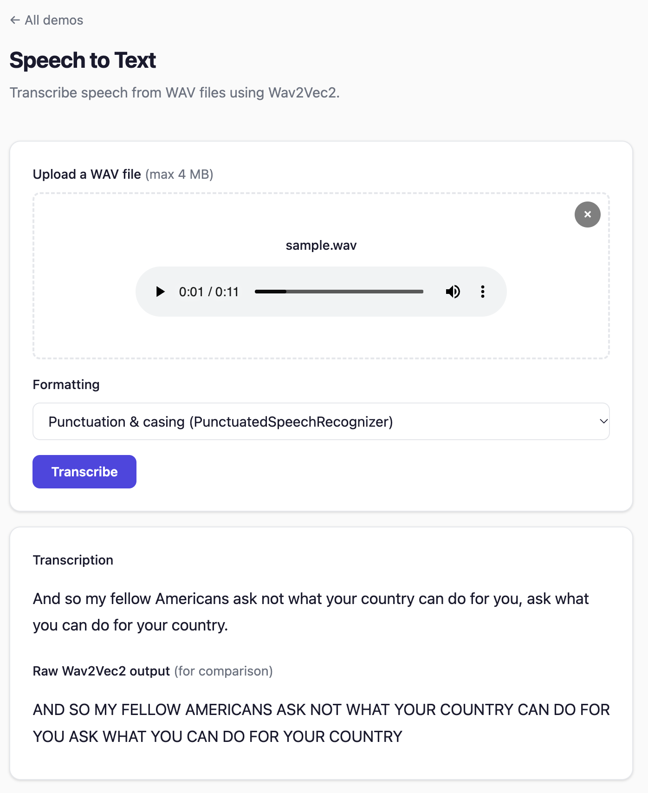

# Speech-to-Text

Transcribe audio files to text. inference4j supports two speech models:

- **Wav2Vec2** (`inference4j-core`), a non-autoregressive CTC model that converts speech to text in a
  single forward pass. Its output is upper-case and unpunctuated, so pair it with a punctuation model
  for readable text.
- **Whisper** (`inference4j-genai`), OpenAI's encoder-decoder model, which generates punctuated,
  cased text directly and can also translate to English.

## Choosing a model

The same 11-second recording through each option:

| Option | Transcript | Time* |
|--------|------------|-------|
| Wav2Vec2 | AND SO MY FELLOW AMERICANS ASK NOT WHAT YOUR COUNTRY CAN DO FOR YOU ASK WHAT YOU CAN DO FOR YOUR COUNTRY | ~0.25 s |
| Wav2Vec2 + [punctuation](#readable-transcripts) | And so my fellow Americans ask not what your country can do for you, ask what you can do for your country. | ~0.22 s |
| [Whisper](#whisper) small | And so my fellow Americans, ask not what your country can do for you, ask what you can do for your country. | ~0.5 s |

\* Measured on an Apple M4 Pro CPU, with the models already loaded.

- **Wav2Vec2**: the fastest and smallest option, and part of `inference4j-core` with no extra
  dependency. Add the punctuation model when people will read the text.
- **Whisper**: the most accurate and readable output, plus 99 languages and translation to English
  (we currently verify English transcription only). It needs the `inference4j-genai` module and is
  slower, because it generates text token by token.

## Quick example

```java
try (var recognizer = Wav2Vec2Recognizer.builder().build()) {
    System.out.println(recognizer.transcribe(Path.of("audio.wav")).text());
}
```

## Full example

```java
import io.github.inference4j.audio.Wav2Vec2Recognizer;
import io.github.inference4j.audio.Transcription;
import java.nio.file.Path;

public class SpeechToText {
    public static void main(String[] args) {
        try (var recognizer = Wav2Vec2Recognizer.builder().build()) {
            Transcription result = recognizer.transcribe(Path.of("speech.wav"));
            System.out.println(result.text());
        }
    }
}
```

## From raw audio data

If you already have audio samples as a float array:

```java
try (var recognizer = Wav2Vec2Recognizer.builder().build()) {
    float[] audioData = loadAudioSamples(); // your audio loading logic
    Transcription result = recognizer.transcribe(audioData, 16000);
    System.out.println(result.text());
}
```

## Readable transcripts

Wav2Vec2 returns upper-case text with no punctuation, which is hard to read and a poor input for cased models such as [named entity recognition](named-entity-recognition.md). Wrap the recognizer in `PunctuatedSpeechRecognizer` to restore punctuation, casing and sentence boundaries:

```java
try (SpeechRecognizer recognizer = new PunctuatedSpeechRecognizer(
        Wav2Vec2Recognizer.builder().build(),
        PunctCapSegModel.builder().stride(64).build())) {
    System.out.println(recognizer.transcribe(Path.of("speech.wav")).text());
}
```

The wrapper is itself a `SpeechRecognizer`, so it can be used anywhere a recognizer is expected. It formats only the transcript text, and closing it closes both the recognizer and the punctuation model. `stride(64)` lets the punctuation model format transcripts of any length; without it, text beyond about 200 words is truncated.

The showcase app shows the difference on the same recording: the formatted transcript, with the raw Wav2Vec2 output below it for comparison.

<figure markdown="span">
  
  <figcaption>Wav2Vec2 wrapped in PunctuatedSpeechRecognizer, compared with the raw output</figcaption>
</figure>

See [Punctuation & Casing](punctuation-and-casing.md) for details and input limits.

## Whisper

`WhisperSpeechModel` lives in the `inference4j-genai` module and runs Whisper through
onnxruntime-genai. It returns the same `Transcription` result:

```java
try (var whisper = WhisperSpeechModel.builder()
        .modelId("inference4j/whisper-small-genai")
        .build()) {
    System.out.println(whisper.transcribe(Path.of("speech.wav")).text());
}
```

Two models are published: `inference4j/whisper-tiny-genai` (~225 MB, fastest) and
`inference4j/whisper-small-genai` (~1.1 GB, more accurate). `WhisperSpeechModel` is not a
`SpeechRecognizer`, so it cannot be passed where a recognizer is expected, such as to
`PunctuatedSpeechRecognizer`; it does not need that wrapper anyway. Long audio is split into
30-second chunks. See [Whisper](../generative-ai/whisper.md) for builder options, translation and
chunking details.

## Builder options

For `Wav2Vec2Recognizer` (see [Whisper](../generative-ai/whisper.md#builder-options) for `WhisperSpeechModel`):

| Method | Type | Default | Description |
|--------|------|---------|-------------|
| `.modelId(String)` | `String` | `inference4j/wav2vec2-base-960h` | HuggingFace model ID |
| `.modelSource(ModelSource)` | `ModelSource` | `HuggingFaceModelSource` | Model resolution strategy |
| `.sessionOptions(SessionConfigurer)` | `SessionConfigurer` | default | ONNX Runtime session config |
| `.vocabulary(Vocabulary)` | `Vocabulary` | auto-loaded from `vocab.json` | CTC vocabulary |
| `.inputName(String)` | `String` | auto-detected | Input tensor name |
| `.sampleRate(int)` | `int` | `16000` | Target sample rate (Hz) |
| `.blankIndex(int)` | `int` | `0` | CTC blank token index |
| `.wordDelimiter(String)` | `String` | `"\|"` | Word separator token in vocabulary |

## Result type

`Transcription` is a record with:

| Field | Type | Description |
|-------|------|-------------|
| `text()` | `String` | The transcribed text |
| `segments()` | `List<Segment>` | Timed segments (empty for Wav2Vec2 and Whisper) |

## Audio requirements

- **Format**: WAV files (loaded automatically from `Path`)
- **Sample rate**: Audio is automatically resampled to the model's target rate (16kHz by default)
- **Channels**: Mono (stereo is downmixed automatically)
- **Duration**: No hard limit, but very long files will use more memory

## How it works

Wav2Vec2 is a **non-autoregressive** model — it processes the entire audio waveform in a single forward pass and produces character-level predictions using CTC (Connectionist Temporal Classification) decoding.

The pipeline:

1. Load and normalize audio from WAV file
2. Resample to 16kHz if needed
3. Run a single forward pass through the model
4. Apply CTC greedy decoding to convert logits to characters
5. Join characters into words using the word delimiter

## Tips

- The default model (`wav2vec2-base-960h`) is trained on English LibriSpeech data. For other languages, use an appropriate fine-tuned model.
- Wav2Vec2 output is upper-case and unpunctuated. Use [`PunctuatedSpeechRecognizer`](punctuation-and-casing.md) for readable text, or before running cased models such as [NER](named-entity-recognition.md).
- Wav2Vec2 works best with clean speech. For noisy audio, consider preprocessing with VAD to extract speech segments first — see [Voice Activity Detection](voice-activity-detection.md).
- Wav2Vec2 is a CTC model (single-pass), not an autoregressive model. It's fast but may be less accurate on complex audio. For better accuracy, multilingual support or translation, use [Whisper](#whisper).
