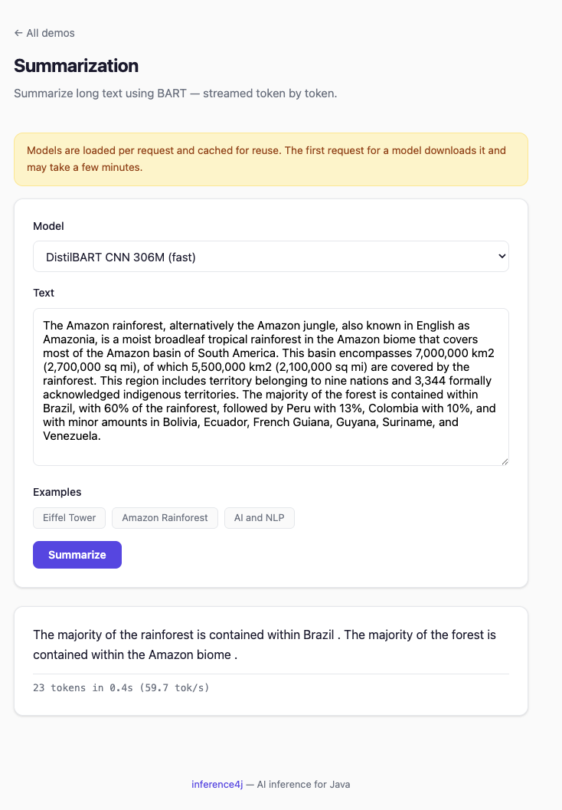

# Text Summarization

Summarize long articles and documents into concise text using BART or Flan-T5 encoder-decoder models.

## Quick example

```java
try (var summarizer = BartSummarizer.distilBartCnn().build()) {
    String summary = summarizer.summarize("Long article text here...");
    System.out.println(summary);
}
```

## Full example

```java
import io.github.inference4j.generation.GenerationResult;
import io.github.inference4j.nlp.BartSummarizer;

public class Summarization {
    public static void main(String[] args) {
        try (var summarizer = BartSummarizer.distilBartCnn()
                .maxNewTokens(150)
                .build()) {

            String article = """
                The Amazon rainforest, often referred to as the "lungs of the Earth",
                produces about 20% of the world's oxygen. Spanning across nine countries
                in South America, it is the largest tropical rainforest in the world,
                covering approximately 5.5 million square kilometers. The forest is home
                to an estimated 10% of all species on Earth, including over 40,000 plant
                species, 1,300 bird species, and 3,000 types of fish. Deforestation
                remains a critical threat, with an estimated 17% of the forest lost in
                the last 50 years due to logging, agriculture, and urban expansion.
                """;

            GenerationResult result = summarizer.summarize(article, token -> System.out.print(token));
            System.out.println();
            System.out.printf("%d tokens in %,d ms%n",
                    result.generatedTokens(), result.duration().toMillis());
        }
    }
}
```

<figure markdown="span">
  
  <figcaption>Screenshot from showcase app</figcaption>
</figure>

## Using Flan-T5 as an alternative

`FlanT5TextGenerator` can also summarize text. It uses a different architecture but implements the same `Summarizer` interface:

```java
import io.github.inference4j.nlp.FlanT5TextGenerator;
import io.github.inference4j.nlp.Summarizer;

// Both implement Summarizer — swap freely
Summarizer summarizer = FlanT5TextGenerator.flanT5Base()
        .maxNewTokens(150)
        .build();
```

## Model presets

### BartSummarizer

| Preset | Model | Parameters | Size |
|--------|-------|-----------|------|
| `BartSummarizer.distilBartCnn()` | DistilBART CNN 12-6 | 306M | ~1.2 GB |
| `BartSummarizer.bartLargeCnn()` | BART Large CNN | 406M | ~1.6 GB |

### FlanT5TextGenerator

| Preset | Model | Parameters | Size |
|--------|-------|-----------|------|
| `FlanT5TextGenerator.flanT5Small()` | Flan-T5 Small | 77M | ~300 MB |
| `FlanT5TextGenerator.flanT5Base()` | Flan-T5 Base | 250M | ~900 MB |
| `FlanT5TextGenerator.flanT5Large()` | Flan-T5 Large | 780M | ~3 GB |

## Builder options

| Method | Type | Default | Description |
|--------|------|---------|-------------|
| `.modelId(String)` | `String` | Preset-dependent | HuggingFace model ID |
| `.modelSource(ModelSource)` | `ModelSource` | `HuggingFaceModelSource` | Model resolution strategy |
| `.sessionOptions(SessionConfigurer)` | `SessionConfigurer` | default | ONNX Runtime session config |
| `.tokenizerProvider(TokenizerProvider)` | `TokenizerProvider` | Preset-dependent | Tokenizer construction strategy |
| `.maxNewTokens(int)` | `int` | `256` | Maximum tokens to generate |
| `.temperature(float)` | `float` | `0.0` | Sampling temperature (higher = more random) |
| `.topK(int)` | `int` | `0` (disabled) | Top-K sampling |
| `.topP(float)` | `float` | `0.0` (disabled) | Nucleus sampling |
| `.eosTokenId(int)` | `int` | Auto-detected | End-of-sequence token ID |
| `.forcedBosTokenId(int)` | `int` | `0` for the BART CNN presets; otherwise `forced_bos_token_id` from `config.json`, if set | Token forced as the first generated token; not part of the output text |
| `.addedToken(String)` | `String` | — | Register a special token for atomic encoding |
| `.maxInputLength(int)` | `int` | Model limit from `config.json` | Maximum input length in tokens |
| `.truncation(TruncationPolicy)` | `TruncationPolicy` | `TRUNCATE` | Longer input: `TRUNCATE` keeps the first tokens and logs a warning, `FAIL` throws `InputTooLongException`. See [Input length](../reference/configuration.md#input-length) |

## Input length

| Model | Default limit | When exceeded | Long-input strategies |
|-------|---------------|---------------|-----------------------|
| BART / DistilBART | 1024 tokens | Truncated with a warning (default), or rejected with `.truncation(TruncationPolicy.FAIL)` | [`MapReduceSummarizer`, `ChunkedSummarizer`](#long-documents) |
| Flan-T5 | 512 tokens (the length T5 was trained on) | Truncated with a warning (default), or rejected with `.truncation(TruncationPolicy.FAIL)` | [`MapReduceSummarizer`, `ChunkedSummarizer`](#long-documents) |

The limit comes from the model's `config.json` and can be changed with `.maxInputLength(int)`.

## Long documents

Two decorators summarize text longer than the model's input limit. Both cut the text into chunks the model
takes whole (whole sentences, up to the input limit by default) and summarize each chunk:

- `MapReduceSummarizer` joins the chunk summaries and summarizes them again, repeating until they fit in
  one call. The result is one summary about as long as a plain call's.
- `ChunkedSummarizer` returns the chunk summaries, one paragraph each. The summary grows with the text and
  covers all of it.

```java
try (Summarizer summarizer = new MapReduceSummarizer(BartSummarizer.distilBartCnn().build())) {
    String summary = summarizer.summarize(longReport);
}

try (Summarizer summarizer = new ChunkedSummarizer(BartSummarizer.distilBartCnn().build())) {
    String summary = summarizer.summarize(longReport);   // one paragraph per chunk
}
```

- **Short input.** Text that fits in one call is summarized exactly as the wrapped summarizer would.
- **Chunk size.** Pass a token budget as the second constructor argument, e.g.
  `new MapReduceSummarizer(summarizer, 512)`; it is capped at the model's input limit.
- **Streaming.** `MapReduceSummarizer` streams only the final call. `ChunkedSummarizer` streams every
  chunk's summary, with the blank lines between them. In both, the streamed text equals `text()`.
- **Result.** Token counts are summed over all calls, and the duration covers the whole call.
- **Limits.** Each chunk is summarized without the rest of the text. `MapReduceSummarizer` logs a warning
  if the chunk summaries stop getting shorter, and then gives them to the final call as they are.

Both work with any `Summarizer` that reports its token budget through `summarizationLimits()`;
`BartSummarizer` and `FlanT5TextGenerator` do. Both are thread-safe, and closing one closes the wrapped
summarizer.

### Evaluation

ROUGE-1 F1 (word overlap with a human summary, 0–100), with ROUGE-1 precision / recall and the average
summary length:

| Configuration | distilbart-cnn-12-6 | flan-t5-base |
|---|---|---|
| **GovReport** (10 reports, 6,464 words; 583-word references) | | |
| Plain: truncated at the input limit | 9.8 (58 / 5, 56 words) | 7.7 (70 / 5, 43 words) |
| `MapReduceSummarizer` | 13.3 (68 / 7, 66 words) | 3.7 (62 / 2, 17 words) |
| `ChunkedSummarizer` | 51.4 (62 / 45, 447 words) | 52.0 (60 / 48, 479 words) |
| **BillSum** (15 bills, 1,920 words; 193-word references) | | |
| Plain: truncated at the input limit | 28.9 (58 / 21, 54 words) | 15.0 (45 / 10, 35 words) |
| `MapReduceSummarizer` | 27.1 (56 / 20, 55 words) | 15.4 (41 / 12, 35 words) |
| `ChunkedSummarizer` | 38.4 (42 / 44, 180 words) | 33.6 (28 / 58, 420 words) |

- **Where content is spread through the document** (GovReport), DistilBART's map-reduce summary beats the
  truncated one at about the same length. Flan-T5's final call compresses the chunk summaries to a few
  words; use DistilBART with `MapReduceSummarizer`.
- **Where the key content comes first** (bills open with their title, findings and purpose), truncation
  loses little, and map-reduce does not help.
- **`ChunkedSummarizer`** scores highest because its longer output matches more of the long references.
  On GovReport its precision stays at the plain level; on BillSum it drops, as later chunks add detail the
  reference leaves out.

Neither model was trained on these documents (DistilBART on news, Flan-T5 on instructions), so compare
rows, not absolute scores. Data: GovReport (CC-BY-4.0, Huang et al., 2021) and BillSum (CC0-1.0) test
splits; greedy decoding, default `maxNewTokens` (256). The evaluation is
`LongDocumentSummarizationEvaluation` in the model tests.

## Result type

Both `summarize(text, tokenListener)` and `generate(text, tokenListener)` return a `GenerationResult` record:

| Field | Type | Description |
|-------|------|-------------|
| `text()` | `String` | The generated summary |
| `promptTokens()` | `int` | Number of tokens in the input |
| `generatedTokens()` | `int` | Number of tokens generated |
| `duration()` | `Duration` | Wall-clock generation time |

The convenience method `summarize(text)` returns the summary as a plain `String`.

## Tips

- **DistilBART CNN** is purpose-built for summarization and produces the best summaries. Use it when summarization is your only task.
- **Flan-T5** is a general-purpose model that also handles translation, grammar correction, and SQL generation. Use it when you need multiple tasks from a single model.
- Lower `maxNewTokens` for shorter summaries — the model will still produce coherent output.
- Use streaming (`summarize(text, token -> ...)`) for long inputs where generation takes several seconds.
- Reuse instances across calls — each one holds the model and tokenizer in memory.
