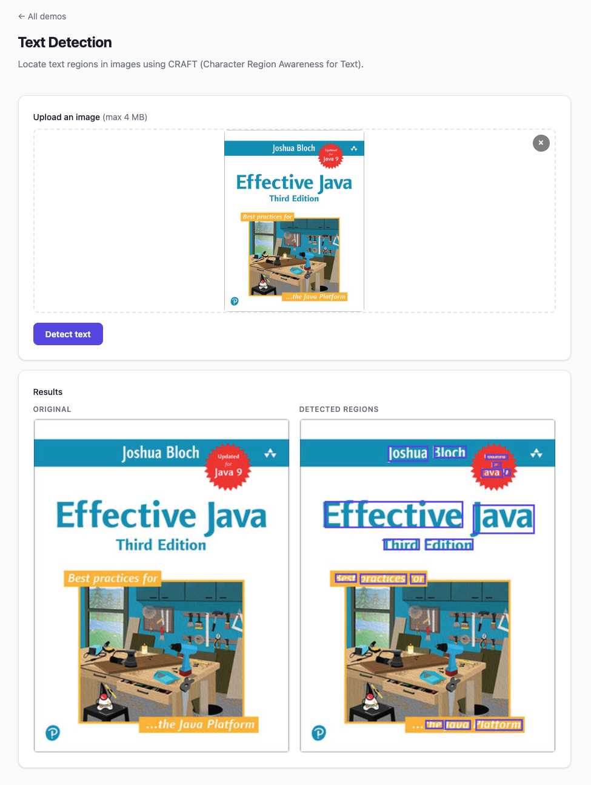

# Text Detection

Detect text regions in images using the CRAFT model. Returns bounding boxes around detected text. To also read the text, see [OCR](ocr.md), whose default detector is PaddleOCR's line detector.

## Quick example

```java
try (var detector = CraftTextDetector.builder().build()) {
    List<TextRegion> regions = detector.detect(Path.of("document.jpg"));
}
```

## Full example

```java
import io.github.inference4j.vision.CraftTextDetector;
import io.github.inference4j.vision.TextRegion;
import java.nio.file.Path;

public class TextDetection {
    public static void main(String[] args) {
        try (var detector = CraftTextDetector.builder().build()) {
            List<TextRegion> regions = detector.detect(Path.of("document.jpg"));

            for (TextRegion r : regions) {
                System.out.printf("[%.1f, %.1f, %.1f, %.1f] (confidence=%.2f)%n",
                    r.box().x1(), r.box().y1(),
                    r.box().x2(), r.box().y2(),
                    r.confidence());
            }
        }
    }
}
```

<figure markdown="span">
  
  <figcaption>Screenshot from showcase app</figcaption>
</figure>

## Custom thresholds

The defaults are those of the reference implementation (`clovaai/CRAFT-pytorch`). Lower `textThreshold` to find
fainter text; raise `linkThreshold` if neighboring words merge into one region:

```java
try (var detector = CraftTextDetector.builder()
        .textThreshold(0.5f)
        .linkThreshold(0.5f)
        .build()) {
    List<TextRegion> regions = detector.detect(Path.of("photo.jpg"));
}
```

`detect(image, textThreshold, lowTextThreshold)` overrides the two text thresholds for one call.

## Builder options

| Method | Type | Default | Description |
|--------|------|---------|-------------|
| `.modelId(String)` | `String` | `inference4j/craft-mlt-25k` | HuggingFace model ID |
| `.modelSource(ModelSource)` | `ModelSource` | `HuggingFaceModelSource` | Model resolution strategy |
| `.sessionOptions(SessionConfigurer)` | `SessionConfigurer` | default | ONNX Runtime session config |
| `.inputName(String)` | `String` | auto-detected | Input tensor name |
| `.targetSize(int)` | `int` | `1280` | Maximum long side of the model input |
| `.magRatio(float)` | `float` | `1.5` | How much smaller images are scaled up, at most |
| `.textThreshold(float)` | `float` | `0.7` | Minimum highest text score for a region to be kept |
| `.linkThreshold(float)` | `float` | `0.4` | Link score above which characters are joined into words |
| `.lowTextThreshold(float)` | `float` | `0.4` | Text score above which a pixel belongs to a character |
| `.minComponentArea(int)` | `int` | `10` | Minimum region area, in score-map pixels (half the input resolution) |

## Result type

`TextRegion` is a record with:

| Field | Type | Description |
|-------|------|-------------|
| `box()` | `BoundingBox` | Axis-aligned box around the region |
| `polygon()` | `List<Point>` | The region's four corners, clockwise; rotated for rotated text |
| `confidence()` | `float` | The region's highest text score (0.0 to 1.0) |

Regions are listed by confidence, highest first.

## How CRAFT works

CRAFT (Character Region Awareness for Text detection) produces two score maps at half the input resolution:

1. **Text score** — highlights character centers
2. **Link score** — highlights the spacing between characters of a word

A pixel belongs to text where its text score exceeds `lowTextThreshold` or its link score exceeds `linkThreshold`.
Each connected area whose highest text score reaches `textThreshold` becomes a region: its link-only pixels are
removed, the rest is dilated in proportion to its thickness, and the smallest rectangle around it, rotated if the
text is, gives the region's outline. Unlike YOLO-style detectors, CRAFT needs no NMS.

inference4j follows the reference implementation step by step, including its resizing (aspect ratio kept, padded to
multiples of 32): on six test images (documents, a photo, a screenshot, a rotated receipt, a noisy scan) it returns
the same 146 regions as the reference, with corners identical to a thousandth of a pixel.

!!! note "Earlier versions"
    Earlier versions kept a region only if its *mean* text score reached `textThreshold`. A region's mean is around
    0.55 even for clear text, so the default 0.7 found nothing, and lower thresholds kept almost everything
    ([#130](https://github.com/inference4j/inference4j/issues/130)). Code that lowered the thresholds to work around
    this can return to the defaults.

## Hardware acceleration

CRAFT benefits significantly from hardware acceleration:

| Backend | Latency | Speedup |
|---------|---------|---------|
| CPU | 831 ms | — |
| CoreML | 153 ms | **5.4x** |

```java
try (var detector = CraftTextDetector.builder()
        .sessionOptions(opts -> opts.addCoreML())
        .build()) {
    detector.detect(Path.of("document.jpg"));
}
```

## Tips

- Both `Path` and `BufferedImage` inputs are supported.
- Images are resized keeping their aspect ratio (scaled up by at most `magRatio`, long side at most `targetSize`) and padded to multiples of 32 (VGG16 backbone requirement).
- CRAFT detects text *locations*, not text *content*. For full OCR, use [`OcrPipeline`](ocr.md); CRAFT can be its detector, which reads each word separately.
- Coordinates are in the original image's pixel space.
