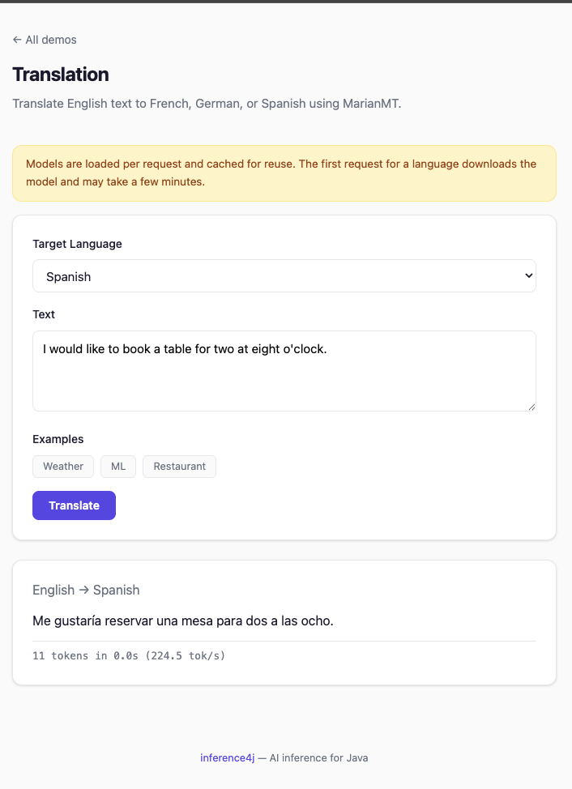

# Machine Translation

Translate text between languages using MarianMT (fixed language pairs) or Flan-T5 (flexible, any-to-any).

## Quick example

=== "MarianMT (fixed pair)"

    ```java
    try (var translator = MarianTranslator.builder()
            .modelId("inference4j/opus-mt-en-fr")
            .build()) {
        String french = translator.translate("The weather is beautiful today.");
        System.out.println(french); // Le temps est beau aujourd'hui.
    }
    ```

=== "Flan-T5 (flexible)"

    ```java
    try (var translator = FlanT5TextGenerator.flanT5Base().build()) {
        String french = translator.translate("The weather is beautiful today.",
                Language.EN, Language.FR);
        System.out.println(french);
    }
    ```

## Full example

```java
import io.github.inference4j.generation.GenerationResult;
import io.github.inference4j.nlp.MarianTranslator;

public class Translation {
    public static void main(String[] args) {
        try (var translator = MarianTranslator.builder()
                .modelId("inference4j/opus-mt-en-de")
                .maxNewTokens(200)
                .build()) {

            GenerationResult result = translator.translate(
                    "Machine learning is transforming how we build software.",
                    token -> System.out.print(token));

            System.out.println();
            System.out.printf("%d tokens in %,d ms%n",
                    result.generatedTokens(), result.duration().toMillis());
        }
    }
}
```

<figure markdown="span">
  
  <figcaption>Screenshot from showcase app</figcaption>
</figure>

## Flexible translation with Flan-T5

`FlanT5TextGenerator` implements the `Translator` interface and can translate between any pair of languages using a single model:

```java
import io.github.inference4j.nlp.FlanT5TextGenerator;
import io.github.inference4j.nlp.Language;

try (var translator = FlanT5TextGenerator.flanT5Base()
        .maxNewTokens(200)
        .build()) {

    // English to French
    String french = translator.translate("Hello, how are you?",
            Language.EN, Language.FR);

    // English to German
    String german = translator.translate("Hello, how are you?",
            Language.EN, Language.DE);

    // French to Spanish
    String spanish = translator.translate("Bonjour, comment allez-vous?",
            Language.FR, Language.ES);
}
```

## Supported languages

The `Language` enum provides constants for the most widely spoken languages. More languages will be added in future releases.

| Constant | Language |
|----------|----------|
| `EN` | English |
| `FR` | French |
| `DE` | German |
| `ES` | Spanish |
| `PT` | Portuguese |
| `PT_BR` | Brazilian Portuguese |
| `IT` | Italian |
| `NL` | Dutch |
| `CA` | Catalan |
| `SV` | Swedish |
| `DA` | Danish |
| `NO` | Norwegian |
| `FI` | Finnish |
| `PL` | Polish |
| `CS` | Czech |
| `HR` | Croatian |
| `RO` | Romanian |
| `RU` | Russian |
| `UK` | Ukrainian |
| `TR` | Turkish |
| `JA` | Japanese |
| `KO` | Korean |
| `AR` | Arabic |
| `ZH_CN` | Chinese Simplified |
| `ZH_TW` | Chinese Traditional |
| `HI` | Hindi |

Each constant provides `displayName()` (e.g., `"Brazilian Portuguese"`) and `isoCode()` (e.g., `"pt-br"`).

## Builder options

| Method | Type | Default | Description |
|--------|------|---------|-------------|
| `.modelId(String)` | `String` | — (required for MarianMT) | HuggingFace model ID (e.g., `inference4j/opus-mt-en-fr`) |
| `.modelSource(ModelSource)` | `ModelSource` | `HuggingFaceModelSource` | Model resolution strategy |
| `.sessionOptions(SessionConfigurer)` | `SessionConfigurer` | default | ONNX Runtime session config |
| `.tokenizerProvider(TokenizerProvider)` | `TokenizerProvider` | `UnigramTokenizer` or `SentencePieceBpeTokenizer`, from `model.type` in `tokenizer.json` | Tokenizer construction strategy |
| `.maxNewTokens(int)` | `int` | `256` | Maximum tokens to generate |
| `.temperature(float)` | `float` | `0.0` | Sampling temperature |
| `.topK(int)` | `int` | `0` (disabled) | Top-K sampling |
| `.topP(float)` | `float` | `0.0` (disabled) | Nucleus sampling |
| `.eosTokenId(int)` | `int` | Auto-detected | End-of-sequence token ID |
| `.forcedBosTokenId(int)` | `int` | `forced_bos_token_id` from `config.json`, if set | Token forced as the first generated token; not part of the output text |
| `.addedToken(String)` | `String` | — | Register a special token for atomic encoding |
| `.maxInputLength(int)` | `int` | Model limit from `config.json` | Maximum input length in tokens |
| `.truncation(TruncationPolicy)` | `TruncationPolicy` | `TRUNCATE` | Longer input: `TRUNCATE` keeps the first tokens and logs a warning, `FAIL` throws `InputTooLongException`. See [Input length](../reference/configuration.md#input-length) |

## Input length

| Model | Default limit | When exceeded | Long-input strategies |
|-------|---------------|---------------|-----------------------|
| MarianMT | 512 tokens | Truncated with a warning (default), or rejected with `.truncation(TruncationPolicy.FAIL)` | [`ChunkedTranslator`](#long-documents) |
| Flan-T5 | 512 tokens (the length T5 was trained on) | Truncated with a warning (default), or rejected with `.truncation(TruncationPolicy.FAIL)` | [`ChunkedTranslator`](#long-documents) |

The limit comes from the model's `config.json` and can be changed with `.maxInputLength(int)`.

## Long documents

Wrap a translator in `ChunkedTranslator` to translate text of any length. It cuts the text into chunks
the model takes whole, translates each, and joins the translations:

```java
try (Translator translator = new ChunkedTranslator(MarianTranslator.builder()
        .modelId("inference4j/opus-mt-en-de")
        .build())) {
    String german = translator.translate(longDocument);
}
```

- **What a chunk holds.** Whole sentences, packed up to the token budget. A chunk never spans a line
  break, so paragraphs, blank lines and indentation come out as they went in. A sentence too long on its
  own is split between words. Sentences are found with the JDK's `BreakIterator`.
- **Token budget.** By default a chunk holds at most a quarter of the translator's `maxNewTokens` in input
  tokens (64 with the default of 256), prompt included. Short chunks fit the output limit, and models
  trained on sentences translate them best (see [Evaluation](#evaluation)). Set it with
  `new ChunkedTranslator(translator, maxChunkTokens)`; it never exceeds the model's input limit. When a
  chunk's translation still reaches `maxNewTokens`, a warning is logged: raise `maxNewTokens` or lower the
  budget. MarianMT's decoder has 512 positions, so keep `maxNewTokens` below 512.
- **Short text** that fits in one chunk is translated in one call, exactly as the wrapped translator would.
- **Streaming** passes the tokens through chunk by chunk, with the whitespace between chunks; the streamed
  text equals `text()`. `promptTokens()` and `generatedTokens()` are summed over all calls, and
  `duration()` covers the whole document.
- **Limits.** Each chunk is translated without the others, so context across chunks (pronouns, gender,
  consistent terms) can be lost at chunk boundaries.

`ChunkedTranslator` works with any `Translator` that reports its token budget through
`translationLimits()`; `MarianTranslator` and `FlanT5TextGenerator` do. It is thread-safe, and closing it
closes the wrapped translator.

### Evaluation

16 documents of 24 consecutive sentences each (450–550 words), with a paragraph break every four
sentences, scored with chrF (character n-gram F-score, 0–100) against the full reference translation:

| Configuration | opus-mt-en-es | flan-t5-base (en→de) |
|---|---|---|
| Plain: whole document, truncated at 512 tokens | 12.8 | 4.3 |
| `ChunkedTranslator`, 64-token chunks | 63.7 | 51.1 |
| `ChunkedTranslator`, 128-token chunks | 64.8 | 39.2 |
| `ChunkedTranslator`, 256-token chunks | 62.9 | 35.5 |
| One call per sentence | 65.5 | 56.4 |

Truncation is not the only loss: on the first 480 tokens of each document, which fit in one call, plain
translation scored 27.1 and 10.0, while 64-token chunks scored 60.7 and 50.1. Both models were trained on
short segments and drop or repeat content in long ones. Chunk runs used `maxNewTokens(500)`.

Data: opus-mt-en-es on News Commentary en-es, which is part of the OPUS data opus-mt was trained on, so
its absolute scores are inflated; flan-t5-base on WMT newstest2018 en→de. Compare rows, not columns. The
evaluation is `LongDocumentTranslationEvaluation` in the model tests.

## Result type

`GenerationResult` is a record with:

| Field | Type | Description |
|-------|------|-------------|
| `text()` | `String` | The translated text |
| `promptTokens()` | `int` | Number of tokens in the input |
| `generatedTokens()` | `int` | Number of tokens generated |
| `duration()` | `Duration` | Wall-clock generation time |

The convenience method `translate(text)` returns the translation as a plain `String`.

## Using your own MarianMT model

The pre-exported models under `inference4j/opus-mt-*` work out of the box. If you want to use a different MarianMT language pair (e.g., `Helsinki-NLP/opus-mt-en-ja`), you'll need to export it yourself.

`MarianTranslator` expects the model directory to contain:

| File | Description |
|------|-------------|
| `encoder_model.onnx` | Encoder ONNX model |
| `decoder_model.onnx` | Decoder ONNX model |
| `decoder_with_past_model.onnx` | Decoder with KV cache |
| `config.json` | Model configuration |
| `tokenizer.json` | HuggingFace fast tokenizer format |

!!! warning "MarianMT models require tokenizer conversion"

    MarianMT models on HuggingFace ship with SentencePiece files (`source.spm`, `target.spm`) and a `vocab.json`
    instead of `tokenizer.json`. `MarianTokenizer` splits text with `source.spm`, a SentencePiece **Unigram**
    model with its own ids, then maps each piece to the model's id through `vocab.json`, the vocabulary shared
    by source and target. A `tokenizer.json` converted straight from `source.spm` has the wrong ids, and BPE
    merges taken from it split words differently, so the translations are garbage or degraded.

    Build a Unigram `tokenizer.json` whose ids come from `vocab.json` and whose scores come from `source.spm`.
    `build_marian_tokenizer` in
    [onnx-exporter](https://github.com/inference4j/onnx-exporter/blob/main/exporter/models/_marian.py) does this,
    and its output matches `MarianTokenizer`'s ids:

    ```python
    from huggingface_hub import hf_hub_download
    from optimum.exporters.onnx import main_export
    from exporter.models._marian import build_marian_tokenizer

    model_id = "Helsinki-NLP/opus-mt-en-ja"

    # 1. Export ONNX models
    main_export(
        model_name_or_path=model_id,
        output="my-model/",
        task="text2text-generation-with-past",
    )

    # 2. Build tokenizer.json from source.spm (segmentation) and vocab.json (ids)
    build_marian_tokenizer(
        hf_hub_download(model_id, "vocab.json"),
        hf_hub_download(model_id, "source.spm"),
        "my-model/tokenizer.json",
    )
    ```

    `MarianTranslator` reads `tokenizer.json` as the model type it names: `Unigram`, or `BPE` for older exports.

    Only standard `opus-mt-*` models are supported. The newer `opus-mt-tc-big-*` variants require target language prefixes (e.g., `>>por<<`) which `MarianTranslator` does not handle.

## Tips

- **MarianMT** models are specialized for a single language pair (e.g., `opus-mt-en-fr` for English→French). They produce higher quality translations for their specific pair but require a separate model per direction.
- **Flan-T5** handles any language pair with a single model, making it more flexible but generally lower quality than a dedicated pair-specific model.
- For bidirectional translation, you need two MarianMT models (e.g., `opus-mt-en-fr` and `opus-mt-fr-en`) — or use Flan-T5 which handles both directions.
- Use greedy decoding (default `temperature=0`) for translation — sampling adds noise without improving quality.
